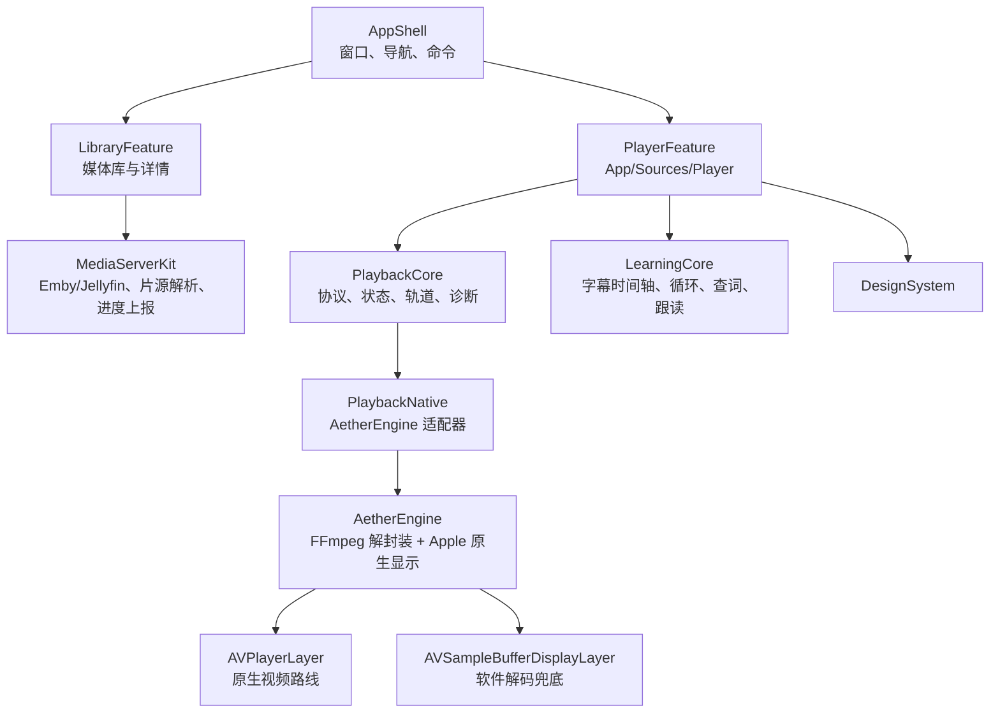
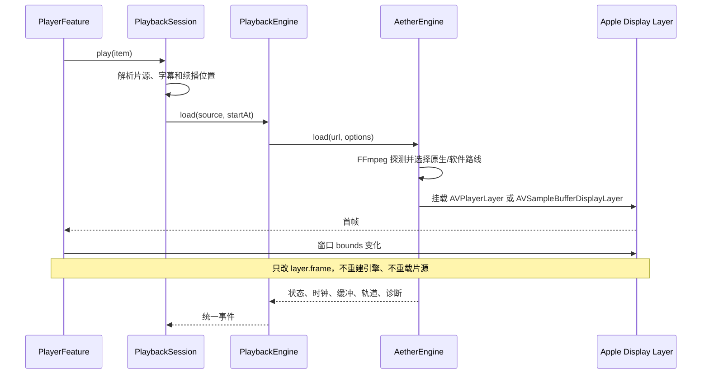

# ELEnglish 架构 V2

## 结论

播放能力改走 Apple 原生显示管线。FFmpeg 只负责读取容器、轨道与时间戳；H.264、HEVC、Dolby Vision 等原生支持的视频重新封装成 HLS-fMP4 后交给 `AVPlayerLayer`，其他编码由软件解码后交给 `AVSampleBufferDisplayLayer`。

旧的 libmpv `wid + CAMetalLayer` 嵌入方式退出正式播放链路。它把窗口尺寸间接绑定到视频输出，底层又没有接收 macOS 窗口缩放事件的入口，只能在“重建视频输出”和“固定低分辨率画布后拉伸”之间二选一：前者闪屏、换片容易黑屏，后者放大后画面和字幕发糊。这不是参数问题，而是显示层所有权设计错误。

## 产品验收标准

| 场景 | 必须达到的结果 |
|---|---|
| 手动拖动窗口 | 画面连续跟手，没有黑帧、白闪、位置跳动和延迟追赶 |
| 放大、缩小、全屏 | 每个尺寸都按当前窗口原生像素输出，视频与字幕保持清晰 |
| 连续换片 | H.264、HEVC、HDR、MKV 等路线切换不复用旧画面状态 |
| 播放控制 | 暂停、跳转、倍速、音轨、字幕不依赖窗口生命周期 |
| 学习功能 | 单句循环、点词、双语字幕只依赖统一播放协议，不认识具体引擎 |
| 可诊断性 | 每次播放明确记录所选路线、首帧耗时、缓冲、丢帧和失败原因 |

## 模块划分

### `PlaybackCore`

- 只放稳定的业务协议和值类型：`PlaybackEngine`、`PlaybackSource`、`PlaybackState`、`Track`、`BufferedRange`、`PlaybackDiagnostics`。
- 不引用 SwiftUI、AppKit、AetherEngine、Emby，也不暴露第三方类型。
- 高频播放时钟独立发布，避免每 100ms 让整个播放页面重新计算。

### `PlaybackNative`

- 只负责把 AetherEngine 的状态和控制翻译成 `PlaybackCore`。
- 持有唯一、长生命周期的引擎实例；换片调用 `load`，不重建显示控制器。
- 显示层由引擎持有，窗口只负责给显示层新的 `bounds`。
- 轨道切换、错误、缓冲和诊断在这里统一转换。

### `PlayerFeature`（`App/Sources/Player`）

- `PlaybackSession` 负责一次用户播放会话：片源准备、进度上报、下一集、学习字幕。
- `PlayerWindow` 只负责窗口和控件，不直接操作解码器、缓存或视频图层。
- 学习字幕是独立叠加层；内嵌字幕也统一转成 cue，观影和学习使用同一条时间轴。

### `MediaServerKit`

- 只处理服务器 API、鉴权、媒体信息和播放进度。
- 返回不带播放器实现细节的 `ResolvedStream`，不能再出现 `libmpv` 专属设备能力或缓存描述。

## 播放生命周期

## 起播策略

- 详情页预热由 AppModel 持有，不跟随页面任务取消；没有完成时立即放弃，不能反过来阻塞用户点击。
- 冷启动并行请求条目和播放信息，原文件直放不为续播位置多等一次服务器往返。
- 当前集首帧稳定后才准备下一集，避免抢占本次起播带宽。
- 慢速网络使用渐进分片：首段边生成边交给 AVPlayer，不等待完整分片写完。
- 每次起播记录连接、容器、轨道、显示准备、路线选择、会话建立和首帧耗时；优化以真实首帧数据为准。

## 强制工程规则

1. 窗口 resize、全屏、停靠面板变化不得调用 `load`、`reload`、切换视频输出或修改解码器。
2. 显示层尺寸变化必须在无隐式动画的事务里同步完成。
3. 播放器第三方类型不得进入 App 和 LearningCore。
4. 一个播放会话只有一个状态所有者；UI 不得自行推断 loading、ended、failed。
5. 片源选择在加载前完成，失败允许一次明确的原生路线到软件路线降级，禁止无限重试。
6. 字幕、音轨、缓存、诊断都有独立模型，不能再堆进一个数百行引擎类。
7. 任何回归修复都要落在对应模块测试里，不能用窗口层补偿播放内核。

## 本次迁移结果

工程只保留一套正式播放路径。App 内按产品功能分目录，稳定协议和第三方播放器适配器下沉为独立 Swift Package；目前没有为了“看起来模块化”把每个页面拆成空壳 Package。

## 验证矩阵

| 类别 | 样片 |
|---|---|
| 容器 | MP4、MOV、MKV、MPEG-TS、WebM、AVI |
| 视频 | H.264、HEVC、HEVC 10-bit、HDR10、Dolby Vision、VP9、AV1、MPEG-2、VC-1 |
| 音频 | AAC、AC-3、E-AC-3、TrueHD、DTS、FLAC |
| 字幕 | SRT、ASS、WebVTT、PGS、外挂字幕 |
| 操作 | 起播、连续换片、拖动缩放、全屏往返、快速 seek、倍速、单句循环、音轨/字幕切换 |

本机已完成 H.264、HEVC、MPEG-4 软件兜底和带 SRT 的 MKV；播放中连续缩放与连续换片均正常出画。HDR、Dolby Vision、Atmos 仍需在 Apple Silicon + HDR 显示设备补齐验证。
