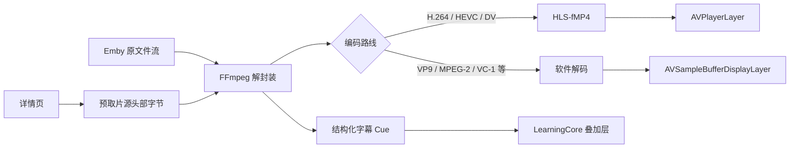

# 技术选型（定稿 v2）

> 日期：2026-10-29
> 原则：这是个人自用项目，播放体验优先于分发授权；所有视频只用一个成熟内核，优先保证 MKV 起播、跳转和音画同步。
> 相关文档：[竞品调研与技术方案](macos-player-research.md)

---

## 0. 先说一个硬件约束

当前开发机实测结果如下（2026-10-28）：

| 项目 | 结果 |
|---|---|
| CPU / 系统 | Intel i5-12400F 黑苹果，macOS 15.7.5，Xcode 26.3，Swift 6.2.4 |
| GPU | AMD RX 560（Polaris，Metal 2） |
| 硬件解码 | H.264 ✅；HEVC ✅；DV HEVC（dvh1）✅；AV1 ❌；VP9 ❌ |
| HDR | `AVPlayer.eligibleForHDRPlayback = false`，屏幕 EDR 上限是 1.0，**无法显示 HDR 或杜比视界** |

由此得出两个决定：

1. **App 要同时编译 arm64 和 x86_64（Universal），最低系统版本定为 macOS 15**。这样这台机器可以完成日常开发和调试：界面、Emby、字幕、学习功能、HDR 片源转成 SDR 后的播放。
2. **杜比视界、HDR、Atmos 空间音频和功耗这几项，必须在 Apple Silicon Mac 上验证**，最好是带 XDR 屏的 MacBook Pro，其次是 Mac mini 加 HDR 显示器。M0 阶段一开始就需要这台设备。

---

## 1. 选型总表

| 层 | 选择 | 版本 | 许可证 | 为什么选它 |
|---|---|---|---|---|
| 语言 | **Swift 6 语言模式**（严格并发检查） | Swift 6.2 | — | 编译期发现数据竞争，播放器这种多线程程序最需要这一点 |
| 构建 | **Xcode 26 + XcodeGen**（`project.yml` 生成工程）+ 本地 Swift Package 分模块 | XcodeGen 已安装 | MIT | 工程文件可以纳入版本管理、不容易冲突；模块之间边界清楚，编译也快 |
| UI | **SwiftUI + Observation（`@Observable`）**；播放窗口用 AppKit（`NSWindow`/`NSView`） | macOS 15 SDK 26 | — | SwiftUI 写界面效率高；全屏、窗口比例、图层这些细节由 AppKit 精确控制。用 Xcode 26 编译后，在 macOS 26 上会自动获得 Liquid Glass 外观 |
| 视频图层 | **AVPlayerLayer / AVSampleBufferDisplayLayer** | 系统 | — | 图层尺寸直接跟窗口同步，缩放不触发解码器重建，也不需要固定画布拉伸 |
| 播放内核 | **AetherEngine 原生/软件双路线** | 7.52.x | LGPL-3.0 + App Store 例外 | FFmpeg 解封装，H.264/HEVC 走 HLS-fMP4 + AVPlayer，其他编码自动走软件解码兜底 |
| 解封装 / 解码 | AetherEngine 的 FFmpeg + VideoToolbox / dav1d / libavcodec | FFmpegBuild 3.11.x | LGPL | 容器兼容与显示职责分离，Apple 原生管线负责 HDR、DV、音画同步和窗口显示 |
| AV1 软解 | **dav1d**（作为 FFmpeg 的依赖一起编进去） | 1.5.x | BSD-2 | 最快的 AV1 软解码器 |
| ASS 特效字幕 | **libass**（观影模式下渲染成位图叠加；学习模式只取纯文本，由我们自己绘制） | 0.17.x | ISC | 番剧和特效字幕要还原到 IINA 的水平，离不开它 |
| 去隔行 | FFmpeg **bwdif** 滤镜（只在软解兜底路径使用） | 跟随 FFmpeg | LGPL | 处理 MPEG-2 / VC-1 / 1080i 隔行片源；构建时不加 `--enable-gpl`，GPL 滤镜会被自动排除 |
| HDR / 杜比片源 | AVFoundation 原生 HDR / Dolby Vision 路线 | 系统 + AetherEngine | LGPL | 让系统完成 EDR、显示能力匹配和动态元数据处理 |
| 网络 / Emby | `URLSession` + async/await + `Codable`，Emby 客户端自己写 | 系统 | — | Emby 只用到二十几个接口，自己写比用第三方 SDK 更可控 |
| 图片缓存 | 自写 `ImagePipeline`（URLCache 磁盘缓存 + NSCache + ImageIO 降采样） | 系统 | — | M1 实测够用，少一个依赖；海报墙出现性能问题再换 Nuke |
| 数据库 | **SQLiteData**（Point-Free，底层是 **GRDB 7**） | 1.x / 7.x | MIT | 用起来像 SwiftData，底层是 SQLite，性能和稳定性都更好；**自带 CloudKit 同步**，M4 做多设备同步时可以直接用 |
| 词典 | **ECDICT**（导入 SQLite，带 FTS 全文索引） | — | MIT | 约 77 万词条，包含音标、词频、考试标签 |
| 分词 / 词形还原 | **NaturalLanguage `NLTagger`** | 系统 | — | 设备端运行，速度快，不需要依赖 |
| 语音识别（ASR） | **whisper.cpp**（模型 large-v3-turbo 量化版；Apple Silicon 上用 Core ML 编码器跑神经网络引擎） | 最新版本 | MIT | **Intel 和 Apple Silicon 都能运行**（WhisperKit 只支持 Apple Silicon），提供词级时间戳；每集只跑一次，结果缓存 |
| ASR 增强（可选） | Apple **SpeechAnalyzer / SpeechTranscriber** | macOS 26+ | — | 在 Apple Silicon + macOS 26 上更快、更省电；M3 阶段再评估词级时间戳的完整度（beta 期间有人反馈时间戳缺失） |
| 字幕翻译（离线） | Apple **Translation 框架** | macOS 15+ | — | 设备端翻译，免费，保护隐私 |
| 字幕翻译 / 讲解（云端，可选） | **Claude API**：整集字幕翻译用 `claude-haiku-5-5`，词组和语法讲解用 `claude-sonnet-5-5` | — | — | 结合上下文翻译，质量明显更好；API Key 由用户自己填写，保存在钥匙串里 |
| 端侧大模型（可选） | Apple **Foundation Models** | macOS 26+，Apple Silicon | — | 做查词时的结合语境讲解，免费、离线；没有这个条件的机器自动降级为词典或云端 |
| 跟读录音 | `AVAudioEngine` | 系统 | — | 低延迟录音，同时可以拿到波形数据 |
| 复习算法 | **swift-fsrs**（FSRS 算法） | 最新版本 | MIT | 目前最好的间隔重复算法，Anki 也在用 |
| 日志 / 性能 | `os.Logger` + `OSSignposter` + Instruments（Energy / Time Profiler） | 系统 | — | 零开销日志，可以直接在 Instruments 里看功耗 |
| 测试 | **Swift Testing**（`@Test`） | Xcode 26 | — | 新一代测试框架，支持并行执行和参数化测试 |
| 代码格式 | `swift format`（Xcode 自带） | — | — | 不需要额外安装 |
| 分发 | **Developer ID 签名 + 公证 + Sparkle 自动更新**；稳定后再评估上架 Mac App Store | Sparkle 2.x | MIT | 不受审核和沙盒限制，迭代快；需要 Apple 开发者账号（99 美元/年） |

**明确不用的东西**：
- libmpv `wid` 窗口嵌入：GUI 工具包缩放时没有可靠的外部 resize 通道，已经实测导致闪屏、黑屏或固定画布放大变糊
- 在窗口层补偿播放内核：固定低分辨率画布、缩放后 reload、重建视频输出都禁止
- VLCKit：HDR/DV 体验差
- KSPlayer 免费版：GPL
- SwiftData：线程问题和性能问题仍然比较多
- Electron / Flutter：功耗高，也拿不到原生 DV 管线
- Metal 自写渲染：没有必要，系统管线更省电

---

## 2. 播放内核细节



窗口缩放只改变 `AVPlayerLayer` 或 `AVSampleBufferDisplayLayer` 的 frame。解封装、解码、缓存、播放时钟和字幕时间轴都不接收窗口事件。

详情页只做轻量字节预热，不再提前创建或暂停一个隐藏播放器。播放缓存由当前会话管理，换片和停止后按会话回收。

稳定性要点（写进代码规范）：
1. H.264 / HEVC 优先使用 VideoToolbox，播放器不自行维护第二套时钟。
2. 拖进度条时只更新预览，松手后只提交最后一次跳转；字幕连点同样采用最后请求生效。
3. 全 App 复用一个长生命周期播放引擎；换片调用 `load`，窗口销毁不销毁引擎。
4. 学习字幕只以 10Hz 检查句子边界，字幕叠加层仅在换句时刷新。
5. **ASR 和翻译是离线批处理**：每集只跑一次，结果写进数据库；插着电源时可以预处理下一集。
6. **系统处于低电量模式时**，暂停后台预处理，并降低网络预读量。

---

## 3. 工程结构

```
elenglish/
├── project.yml                 # XcodeGen 配置
├── App/                        # SwiftUI App 入口、窗口、菜单、快捷键
├── Packages/
│   ├── MediaServerKit/         # ✅ Emby 客户端（Jellyfin 待做）
│   ├── PlaybackCore/           # ✅ 播放协议、状态、轨道、缓冲区间和诊断模型
│   ├── PlaybackKit/            # ✅ AetherEngine 适配器与原生播放 Surface
│   ├── LearningCore/           # ✅ 字幕与学习层的核心模型和扩展协议，不依赖界面和播放内核（见 subtitle-learning-design.md）
│   ├── SubtitleKit/            # SRT/VTT/ASS 解析、断句、中英对齐、OCR
│   ├── TranscriptionKit/       # whisper.cpp 与 SpeechAnalyzer 的统一接口
│   ├── LearningKit/            # 词典、生词本、FSRS、跟读打分、高频词表
│   ├── Persistence/            # SQLiteData 数据模型和迁移
│   ├── DesignSystem/           # ✅ 主题令牌、主题存储、可替换样式的组件、图片加载
│   └── Workspace/              # ✅ 面板注册、停靠布局、布局预设与存储
├── Vendor/                     # 预编译的 xcframework（FFmpeg、dav1d、libdovi、whisper），由脚本生成
├── Scripts/                    # build-ffmpeg.sh、build-libdovi.sh、fetch-ecdict.sh
└── docs/
```

各模块的依赖方向是单向的：`App → PlaybackKit → PlaybackCore`，`PlaybackKit → AetherEngine`。学习层只依赖 `SegmentPlayer`，不依赖任何具体播放内核。

---

## 4. 开发环境准备

| 项目 | 状态 |
|---|---|
| Xcode 26.3 | ✅ 已安装 |
| Homebrew、XcodeGen | ✅ 已安装 |
| Rust 工具链（只用来编译 libdovi） | ❌ 需要安装：`rustup` 并添加 `aarch64-apple-darwin` 和 `x86_64-apple-darwin` 两个目标 |
| nasm（编译 FFmpeg 的 x86 汇编优化需要）、meson + ninja（编译 dav1d 需要） | ❌ 需要用 brew 安装 |
| Apple 开发者账号 | 公证和分发时才需要，M0–M2 阶段不需要 |
| Apple Silicon Mac + HDR 屏 | ❌ M0 验证杜比视界时必须有 |

---

## 5. 需要在 M0 阶段确认的选型假设

| 假设 | 验证方法 | 如果不成立怎么办 |
|---|---|---|
| 详情页预热后点击到首帧小于 500ms | 对真实 115 MKV 打点 | 调整 AetherEngine 头部预热和探测预算 |
| 已缓存位置跳转小于 400ms | 连续拖动和字幕跳转测试 | 扩大前后向包缓存 |
| 长时间播放音画不同步不持续扩大 | 连续播放两小时记录 `avsync` | 固定以音频为主时钟并收集异常片源 |
| whisper.cpp 在 Intel 机器上转写一集 45 分钟所需时间可以接受 | 在当前开发机上实测 | Intel 机器默认只用已有字幕，ASR 作为可选功能 |

---

## 6. M1 现状（2026-10-29）

已完成并验证：
- XcodeGen 工程，Swift 6 严格并发；PlaybackCore 与 PlaybackKit 分离业务协议和具体引擎
- 主题令牌（3 个内置主题 + JSON 用户主题，局部覆盖继承）、面板注册、停靠布局（左 / 右 / 底 / 独立窗口，可拖动大小，预设，自动保存）
- Emby：登录、媒体库、继续观看、接下来看、最新、搜索、详情、分季分集、标记已看、原文件直放与播放进度上报
- 播放窗口：AetherEngine 原生/软件双路线、续播、控制条自动隐藏、倍速、音量、音轨、HUD 提示、播放下一集
- 本地视频：菜单「打开本地视频」或访达「用 ELEnglish 打开」

**当前直放方案（重要）**：Emby 仍提供原文件地址；AetherEngine 在本机解封装，并按编码选择 HLS-fMP4 + AVPlayer 或软件解码 + AVSampleBufferDisplayLayer。服务器不转码。

已连接真实 Emby 4.8.10 服务器完成端到端联调；开发机实测无需服务器转码权限即可播放 MP4 和 MKV。

### 界面按 Rex 设计系统重做（2026-10-28）

- DesignSystem 的令牌换成 Rex：28 个颜色令牌（深色 / 浅色两套值）、8 级文字样式、5 级圆角、4px 间距单位、浮动阴影。
- 组件：白色胶囊主按钮、玻璃按钮组、圆形图标按钮、胶囊切换、分段进度、状态圆点、角标、海报 / 横版卡片。
- 首页、详情页按 Rex 的「背景随内容变色」：从剧照取平均色并压暗作为整页底色。
- 主窗口：浮动侧边栏（surface-raised + radius-xl）；播放窗口：玻璃浮动控制条，停靠面板改成离窗口边缘留空的浮动面板。
- 已用本地模拟 Emby 服务器端到端检查首页、详情页、播放窗口的实际渲染；尚未连接真实 Emby 服务器验证。
